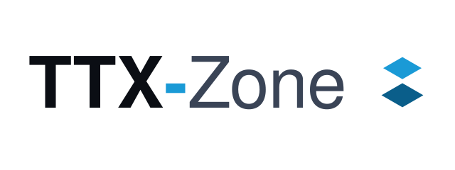

<p align="center">
  <picture>
    <source media="(prefers-color-scheme: dark)" srcset="frontend/src/assets/logos/logo-modo-dark.svg">
    <source media="(prefers-color-scheme: light)" srcset="frontend/src/assets/logos/logo-modo-light.svg">
    
  </picture>
</p>

<p align="center"><em>Build muscle memory into your organization.</em></p>

<p align="center">
  <a href="https://ttxzone.com/">Website</a> ·
  <a href="https://docs.ttxzone.com/">Documentation</a> ·
  <a href="https://github.com/pasket/ttxzone/releases">Releases</a> ·
  <a href="https://github.com/pasket?tab=packages&repo_name=ttxzone">Container images</a>
</p>

TTX-Zone is a self-hosted web application for designing, running and evaluating cybersecurity tabletop exercises: the needs analysis, the scenario and its injects, the live session with its Players, the evaluation, the after-action report and the improvement plan. Free and open source under the [AGPL-3.0](#license).

What it is and who it's for: [ttxzone.com](https://ttxzone.com/). How to use it, install it and run it: [docs.ttxzone.com](https://docs.ttxzone.com/). This README is about the code.

## Releases and images

Each release is a [GitHub release](https://github.com/pasket/ttxzone/releases) with its notes from [`CHANGELOG.md`](./CHANGELOG.md), and two images on the GitHub Container Registry for `linux/amd64` and `linux/arm64`, built and published only from the release tag, after the full test suite and the browser tests pass on it:

| Image | Runs |
|---|---|
| `ghcr.io/pasket/ttxzone-backend` | The API (internal or the Players' public face), the background worker and the database migrations |
| `ghcr.io/pasket/ttxzone-frontend` | The web application, served by Nginx |

Each is tagged with its version (`0.1.0`), its minor line (`0.1`) and `latest`, and carries an SBOM and build provenance. Pin the exact version. While TTX-Zone is 0.x, the API and the file formats may change between versions: read the changelog before upgrading.

## Run it on a server

[`deploy/`](./deploy/) is a production deployment for one Docker host: PostgreSQL, a one-shot migration, the API, the worker, the frontend and a TLS reverse proxy, the only service that publishes a port.

```bash
git clone https://github.com/pasket/ttxzone.git
cd ttxzone/deploy
cp .env.example .env      # version, hostname, secrets
# certificate in certs/fullchain.pem and certs/privkey.pem
docker compose pull
docker compose up -d
docker compose exec api python -m scripts.instance_admin grant you@example.org   # after registering that account
```

Choose a model first: [an internal tool, or an exercise with Players connecting from the Internet](https://docs.ttxzone.com/instance/deployment-models/) (`--profile public` on the same host, or [`deploy/public-host/`](./deploy/public-host/) on a separate one in a DMZ). Then [install](https://docs.ttxzone.com/instance/install/), [configure](https://docs.ttxzone.com/instance/configuration/) and [back up](https://docs.ttxzone.com/instance/backup-and-restore/).

## Develop

You need Docker with Compose. Node.js 22+ and Python 3.12+ only to run the apps outside Docker.

```bash
cp .env.example .env      # set SECRET_KEY and DATA_ENCRYPTION_KEY (a Fernet key)
# openssl rand -base64 32 | tr '+/' '-_'
docker compose up --build
```

The frontend's dev server is on http://localhost:5173 and the API on http://localhost:8000 (health: `/api/v1/health`). The backend applies migrations when it starts.

A demo organization with an exercise ready to conduct, and an account for every role:

```bash
docker compose exec backend python -m scripts.seed_demo --extras
docker compose exec backend python -m scripts.seed_demo --codes   # current two-factor codes
```

Or start empty: register an account, then make it the instance administrator with `docker compose exec backend python -m scripts.instance_admin grant you@example.com`. Set `TENANCY_MODE=open` in `.env` to let any account create organizations while developing.

### Checks

CI (GitHub Actions) runs these on every push to `main`, on every pull request, and on demand. Run them before pushing:

```bash
# backend/ (inside the container: docker compose exec backend …)
ruff check . && ruff format --check .
alembic upgrade head && alembic check
pytest                  # in the container: docker compose exec -T -e POSTGRES_DB=ttx_zone_test backend pytest -q

# frontend/
npm run lint && npm run format:check && npm run build && npm test
npm run e2e             # browser tests, on their own stack

# docs/site/
npm ci && npm run build
```

Always point the backend tests at `ttx_zone_test` inside the container: they drop and recreate the schema of the database they're given.

## Repository layout

```
backend/     FastAPI application: app/{api,core,middlewares,models,schemas,services,data}, alembic/, tests/, scripts/
frontend/    React application: src/{components,hooks,lib,locales,assets}, tests/, e2e/
deploy/      production Compose files and the reverse proxy
docs/        maintainers' reference: architecture, features, decisions
docs/site/   the documentation site published at docs.ttxzone.com
.github/     CI, browser tests, release and documentation workflows
```

Stack: TypeScript, React, Vite, Tailwind CSS and i18next; Python, FastAPI, SQLModel, Alembic and PostgreSQL 16. The two apps share no code and talk only through the HTTP API. How the code is organized and the rules it follows: [Architecture](https://docs.ttxzone.com/contributing/architecture/).

## Contributing and security

Contributions are welcome: [`CONTRIBUTING.md`](./CONTRIBUTING.md) and the [contributing guide](https://docs.ttxzone.com/contributing/). Report vulnerabilities privately as described in [`SECURITY.md`](./SECURITY.md), never in a public issue.

## License

TTX-Zone is free software, released under the [GNU Affero General Public License v3.0 or later](./LICENSE) (AGPL-3.0-or-later), with the additional terms in [`NOTICE`](./NOTICE). It's built to be shared with the community: use it, learn from it, improve it.

What that means in plain words:

- **You're free** to use, study, modify and share TTX-Zone — on your laptop, on your company's servers, for your own exercises or for paid work with your clients.
- **One thing in return:** if you modify TTX-Zone and let other people use your version over a network (a SaaS, a hosted instance for clients), you must offer those users the source code of your modified version, under this same licence. Improvements stay open for everyone.
- **Running it unmodified** only asks you to keep the notices and the link to this repository.
- **Keep the credits.** The About screen must keep "TTX-Zone, created by Andoni Valverde" and the link to the original source; a modified version must say it's modified and use a name of its own (the TTX-Zone name and logo aren't licensed).
- **Contributions are welcome**, under the same licence — see [`CONTRIBUTING.md`](./CONTRIBUTING.md). Security issues: [`SECURITY.md`](./SECURITY.md).

This summary is a friendly guide, not the licence: [`LICENSE`](./LICENSE) and [`NOTICE`](./NOTICE) are what apply.
